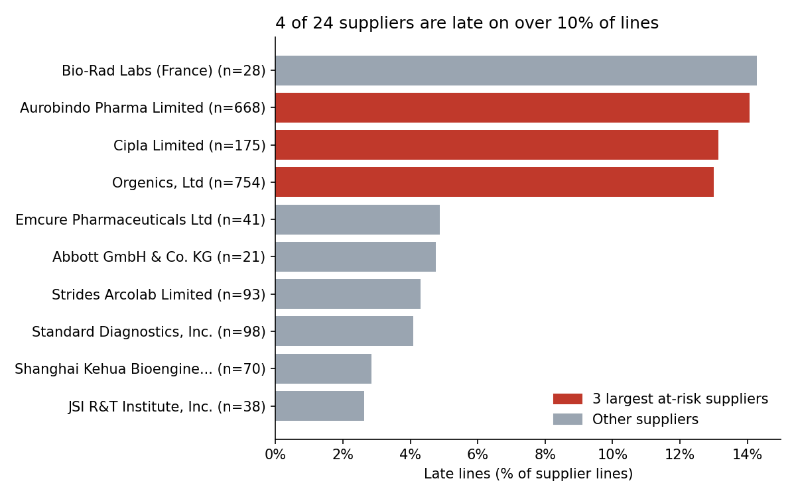
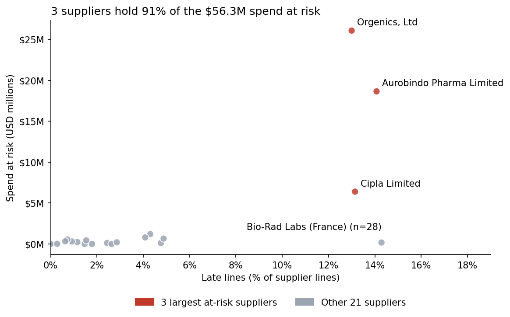

# SCMS Supplier Delivery Analysis

## Summary
Which suppliers deliver late most often, and how much spend is exposed? 10,324 line items, 2006 to 2015, 24 suppliers with 20+ lines.

I cleaned the data in pandas, set aside the 5,404 RDC lines, and measured late rate, days late and spend at risk (value of late lines) per supplier.

Orgenics, Aurobindo Pharma, Cipla hold 91% of the $56.3M spend at risk. Their late rates are similar (13.0% to 14.1%) but their median delays run from 5 to 33 days. RDC lines are late 17.2% of the time against 5.3% for direct drop.

Review Orgenics, Ltd, Aurobindo Pharma Limited, Cipla Limited first, since together they hold 91% of the spend at risk. Ask each why 13.0% to 14.1% of their lines arrive late, and whether the median delay of 5 to 33 days is a scheduling or a delivery problem.

Limit: the median gap between scheduled and delivered is 0 days, so scheduled dates may have been revised and the 88.5% on-time rate may flatter suppliers.
Without the 224 lines more than 90 days early, on-time is 88.3% instead of 88.5%.

## Charts

## Cleaning log
Cleaning log: SCMS Delivery History (10,324 rows, 33 columns)

1. Raw data kept untouched in `raw`; all work done on a copy (`df`).
2. Duplicates: 0 duplicate rows and 0 duplicate IDs found. No action needed.
3. Vendor names: 70 lines had a double space in one vendor name (Shanghai Kehua Bioengineering Co.,Ltd (KHB)). Collapsed to single spaces. Vendor count stayed 73 before and after, so no names were merged and there were no spelling variants
4. Dates: Scheduled and Delivered dates were text (d-Mon-yy). Converted both with an explicit format; 0 failed.
5. Line Item Value: already numeric, 0 text entries. 17 lines have a value of 0; kept because they are real lines. They count in lateness but add $0 to spend at risk.
6. Freight Cost (USD) dropped: 4,126 text entries (40%), e.g. "Freight Included in Commodity Cost". Not needed for lateness.
7. Weight (Kilograms) dropped: 3,952 text entries (38%), e.g. "Weight Captured Separately". Not needed for lateness.
8. Outliers kept: 224 lines delivered more than 90 days early and 40 more than 90 days late. Early counts as on time,
   and late days will be reported with the median as well as the mean.
9.  SCMS from RDC flagged with is_rdc: 5,404 lines (52%). The count matches Fulfill Via = "From RDC" (5,404), so these are lines shipped from the distribution centre, not from an outside supplier. Reported separately from supplier rankings.
10. Columns not used were left as is: Dosage Form (1,736 missing), Line Item Insurance (USD) (287 missing), PQ First Sent to Client Date (360 missing).
11. Reconciled with Day 121: 10,324 rows, 6,233 PO/SO numbers, on-time rate 0.885, 24 suppliers with 20+ lines.
12. Saved the clean data as scms_clean.csv in Phase5

## Checks and limits
- Without the 224 lines more than 90 days early, on-time is 88.5%
- Apart from the three large suppliers, most rates rest on few late lines: the other 21 suppliers have 0 to 11 late lines (median 1)
- Freight cost not analysed (4,126 text entries).
- Data ends in 2015, so findings describe history.

## Files
data/raw and data/clean hold the original and cleaned CSVs; notebook has the cleaning and analysis; images has the charts.

## Data source
USAID / PEPFAR SCMS Delivery History (Supply Chain Shipment Pricing Data). Copy from GitHub repo MatheusNelvam/DB2-RDF-Project.

## How to rerun
The notebook read from a Google Drive folder. Upload the files from data/ and change the path.
